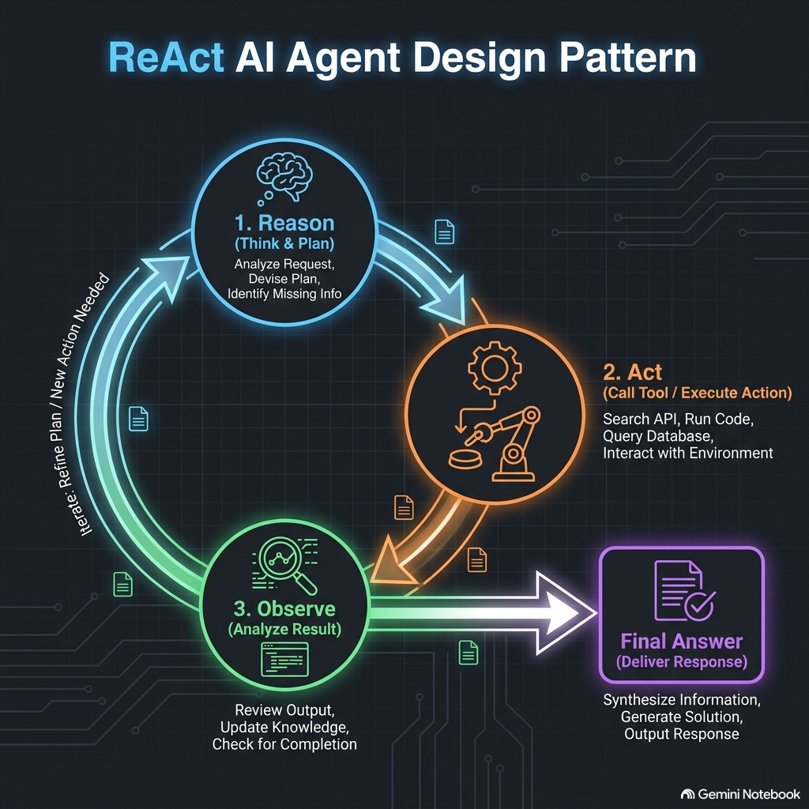

Git-ready documentation for the **ReAct (Reason + Act)** agent design pattern.

---

### ReAct Pattern Architecture

Below is a visual concept diagram illustrating how the ReAct loop alternates between reasoning, acting, and observing until a final answer is produced:



---

### 📄 Git-Ready Documentation (`REACT_PATTERN.md`)

You can copy and save the section below directly as a Markdown file (e.g., `REACT_PATTERN.md`) for your Git repository:

```markdown
# ReAct (Reason + Act) AI Agent Design Pattern

## 1. Overview & Core Concept
The **ReAct (Reason + Act)** pattern is a foundational single-agent architecture that enables an AI agent to solve complex, multi-step problems by alternating between **reasoning** ("thinking"), **acting** ("calling a tool"), and **observing** ("evaluating the tool output") in a dynamic loop.

Unlike static sequential chains, ReAct does not require pre-defined paths. Before every tool call, the agent explicitly reasons about its current state and intermediate results to determine the next logical action.

### Relatable Example: The IT Support Detective
Imagine an IT support technician investigating why a user cannot access their email:
1. **Thought**: *"I should first check if the user's account is locked in Active Directory."*
2. **Action**: Calls `check_account_status(user_id="john.doe")`.
3. **Observation**: Returns `Status: Active`.
4. **Thought**: *"The account is active. Next, I need to check the email server status."*
5. **Action**: Calls `get_server_health(service="Exchange")`.
6. **Observation**: Returns `Exchange Server 3: High Memory Utilization / Unresponsive`.
7. **Thought**: *"The email server is down. I now have the root cause to explain to the user."*
8. **Final Answer**: *"You cannot access email because Exchange Server 3 is experiencing an outage."*

---

## 2. Where to Use ReAct (Problem Types)
The ReAct pattern is ideal for problem domains with the following characteristics:
* **Dynamic / Non-Linear Problems**: Tasks where the exact sequence of steps cannot be predicted upfront and depends on intermediate discovery.
* **Tool-Dependent Workflows**: Problems requiring external APIs, database queries, calculators, or web searches.
* **Exploratory Troubleshooting & Root Cause Analysis**: Scenarios requiring hypothesis testing, checking diagnostic data, and refining next steps based on observations.
* **Multi-Turn Information Retrieval**: Workflows that require fetching information from multiple distinct sources before synthesizing a final answer.

---

## 3. Real-World Use Cases

| Industry / Domain | Use Case Description | Tools Used |
| :--- | :--- | :--- |
| **Procurement & ERP** | **Source of Supply Explainer**: Investigating why a vendor was assigned to a Purchase Requisition by fetching contracts, quota splits, and price tiers step-by-step. | `get_pr_details`, `fetch_valid_vendors`, `check_quota_rules` |
| **E-Commerce Support** | **Order Refund & Dispute Resolution**: Checking order status, tracking shipments, verifying refund eligibility rules, and initiating refunds. | `get_order_status`, `check_policy`, `issue_refund` |
| **Financial Services** | **Fraud Investigation**: Examining transaction history, flagging suspicious location anomalies, and temporarily freezing cards if risk thresholds are met. | `get_transactions`, `check_ip_geo`, `freeze_card` |
| **Software Operations** | **Automated Incident Response**: Reading error logs, checking service metrics, restarting pod instances, and verifying recovery. | `query_logs`, `check_k8s_metrics`, `restart_service` |

---

## 4. Production Code Template (LangGraph Implementation)

```python
"""
ReAct (Reason + Act) Agent Pattern Implementation using LangGraph.
Requirements: langgraph, langchain-core
"""

from typing import TypedDict, Annotated, List, Dict, Any
import operator
from langgraph.graph import StateGraph, START, END

# ------------------------------------------------------------------
# 1. DEFINE STATE SCHEMA
# ------------------------------------------------------------------
class ReActState(TypedDict):
    """
    Shared memory state holding conversation history and internal loop variables.
    """
    messages: Annotated[List[str], operator.add]
    intermediate_steps: List[Dict[str, Any]]
    is_finished: bool

# ------------------------------------------------------------------
# 2. DEFINE NODE FUNCTIONS
# ------------------------------------------------------------------
def reason_node(state: ReActState) -> dict:
    """
    Evaluates current state and decides whether to call a tool or finish.
    In production, this node calls an LLM with tool definitions attached.
    """
    last_msg = state["messages"][-1] if state["messages"] else ""
    
    # Simple mock reasoning logic (replace with LLM call)
    if "Observation:" in last_msg:
        # LLM evaluates observation and concludes task
        thought = "Thought: I now have all required details to answer."
        final_ans = "Final Answer: The server outage caused the login failure."
        return {
            "messages": [f"{thought}\n{final_ans}"],
            "is_finished": True
        }
    else:
        # LLM decides to call a tool
        thought = "Thought: I need to fetch server diagnostic logs."
        action = "Action: call_tool(get_server_logs)"
        return {
            "messages": [f"{thought}\n{action}"],
            "is_finished": False
        }

def act_node(state: ReActState) -> dict:
    """
    Executes requested tool and returns observation to state.
    """
    # Simulate tool execution
    observation = "Observation: Server 3 memory usage is at 99% (Outage)."
    return {
        "messages": [observation],
        "intermediate_steps": [{"tool": "get_server_logs", "result": observation}]
    }

# ------------------------------------------------------------------
# 3. CONDITIONAL ROUTER
# ------------------------------------------------------------------
def route_next_step(state: ReActState) -> str:
    """
    Inspects state to determine whether to execute tool or exit graph.
    """
    if state.get("is_finished", False):
        return END
    return "act"

# ------------------------------------------------------------------
# 4. ASSEMBLE GRAPH
# ------------------------------------------------------------------
workflow = StateGraph(ReActState)

# Add Nodes
workflow.add_node("reason", reason_node)
workflow.add_node("act", act_node)

# Add Edges & Conditional Routing
workflow.add_edge(START, "reason")
workflow.add_conditional_edges(
    "reason", 
    route_next_step, 
    {"act": "act", END: END}
)
workflow.add_edge("act", "reason")  # Loop back to reason after tool execution

# Compile Executable Application
app = workflow.compile()

# ------------------------------------------------------------------
# 5. EXECUTION EXAMPLE
# ------------------------------------------------------------------
if __name__ == "__main__":
    initial_input = {"messages": ["User: Why is email not working?"], "intermediate_steps": [], "is_finished": False}
    
    print("--- Executing ReAct Loop ---")
    for step in [suspicious link removed](initial_input, stream_mode="values"):
        print("\nLatest Message Added:")
        print(step["messages"][-1])
```

---

## 5. Key Advantages & Limitations

### Advantages
* **High Transparency & Traceability**: Each step explicitly records thoughts and observations, making agent reasoning audit-ready.
* **Dynamic Flexibility**: Adapts to unexpected tool outputs without needing rigid if-else code paths.
* **Reduced Hallucinations**: Direct tool verification grounds LLM claims in real data.

### Limitations
* **Higher Latency & Token Cost**: Multiple LLM calls in a loop increase response times and API expense.
* **Risk of Infinite Loops**: Poorly grounded tool responses can cause the agent to repeat actions infinitely (mitigate using `max_iterations` limits).
```

---
